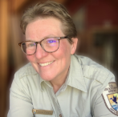
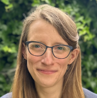
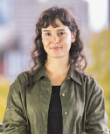
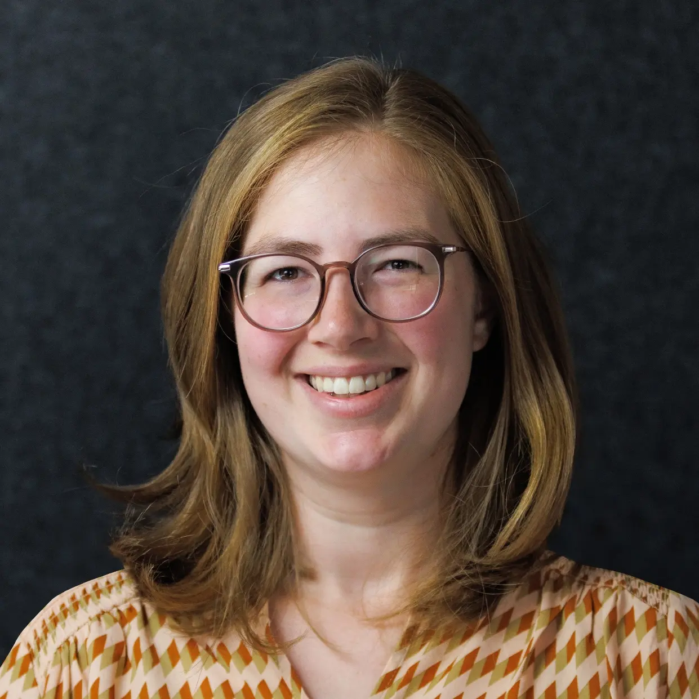

__All community partner workshops are on Sunday, November 8, 2026 from 10:45-11:45 AM__

## Workshop #1: Finding Emotional Resilience in Working with Tough Topics

 
<i> Julia Pinnix, Visitor Services Manager at [US Fish and Wildlife (Nisqually)](https://www.fws.gov/refuge/billy-frank-jr-nisqually) </i>
  
Julia Pinnix was carried into now-vanished glacial ice caves on Mount Rainier as a baby. Her path accordingly led to glaciers in Alaska and the Pacific Northwest and a career helping visitors to our public lands understand climate change. She is currently the Visitor Services Manager for Nisqually National Wildlife Refuge Complex, U.S. Fish and Wildlife Service, in Olympia, Washington.

## Workshop #2: Pursuing Applied Climate Science Research Outside Academia

 
<i> Claire Zarakas, Research Scientist at [CarbonPlan](https://carbonplan.org/) </i>
  
Claire Zarakas is a research scientist at CarbonPlan, a research nonprofit. She received her BA in Geosciences from Princeton University and her PhD in Atmospheric Sciences from the University of Washington, where she was a DOE Computational Science Graduate Fellow. She then joined CarbonPlan as a Schmidt Sciences fellow with a joint appointment at the University of California, Irvine. Previously, she worked at a public sector consulting firm where she conducted research to inform climate mitigation and adaptation policies.

## Workshop #3: Climate Journalism in an Age of Misinformation
 
 
<i> Claire Thompson and Kate Yoder, Data Journalists at [Grist](https://grist.org/) </i>
  
Claire Elise Thompson is an associate editor at Grist, and the writer of the weekly solutions newsletter, Looking Forward. She has been at Grist since 2018, focusing on telling stories about climate solutions and the people leading them. She was a 2022 MJ Bear fellow with the Online News Association and participated in the inaugural Climate Beacons Newsroom Initiative with the Solutions Journalism Network. She is based in Seattle.

Kate Yoder is a senior staff writer covering climate change through the lens of language, culture, and history. Her work has received a FOLIO: Eddie & Ozzie Award and a SEAL Environmental Journalism Award for bringing fresh perspective and social relevance to environmental issues. She has been at Grist since 2015 and is based in Seattle.
